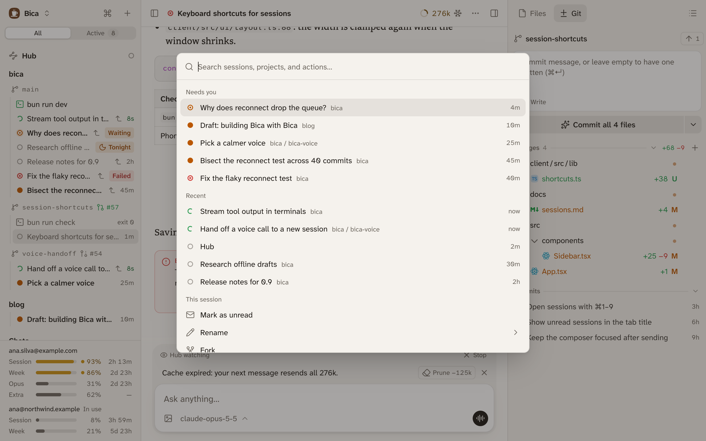

The command palette is one search box for going anywhere and doing anything in Bica. Press ⌘K (Ctrl+K on Windows and Linux) on any page, even while typing in the composer or a terminal. On the phone, the ⌘ button at the top of the sidebar opens it.

## What it shows

Opened empty, it lists what needs you first:

- Needs you: sessions waiting for an answer, then unread replies, then failures ([statuses](/docs/basics/sessions/#status-shows-which-sessions-need-you)).
- Recent: the other sessions, last active first.
- This session: actions for the open session, such as Rename, Fork, and Archive.
- Actions: everything else, such as New session in…, Go to workspace…, Theme…, and Settings.

Typing searches sessions, workspaces, terminals, and actions together. Typos are fine, so "nwe sess" still finds New session, and actions answer to other words too, so "dark" finds Theme…. Files aren't listed; use the [Files tab](/docs/basics/files/) for them.

An action ending in "…" opens a second list, such as the workspaces to start a session in. Esc or Backspace in the empty box goes back.

## The shortcuts worth learning

Each row in the palette shows its shortcut, so you pick them up as you go. These are the ones you'll use most:

| Keys | What it does |
| --- | --- |
| ⌘K | Opens the command palette. |
| ⇧⌘O | Starts a new session in this page's workspace. |
| ⌥⇧↓ | Opens the next session that needs you. Press again to move on. |
| ⌃\` (Control and backtick) | Opens a terminal in this page's workspace. |
| ⌘B / ⌥⌘B | Shows or hides the sidebar / the side panel. |
| ⌘/ | Lists every shortcut. |

On Windows and Linux, press Ctrl wherever a shortcut shows ⌘. [Keyboard shortcuts](/docs/reference/shortcuts/) has the full list, including the composer's keys.

## Next

- [Layout and side panel](/docs/basics/layout/): what ⌘B and ⌥⌘B show and hide.
- [Sessions](/docs/basics/sessions/): what each status means.
