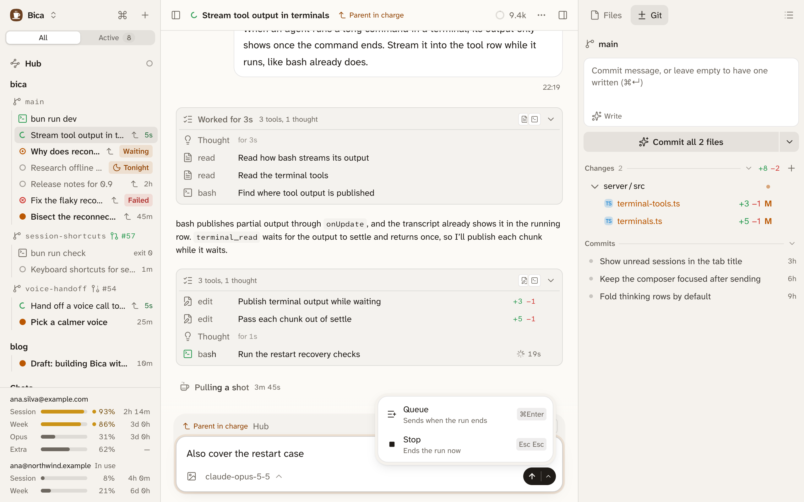
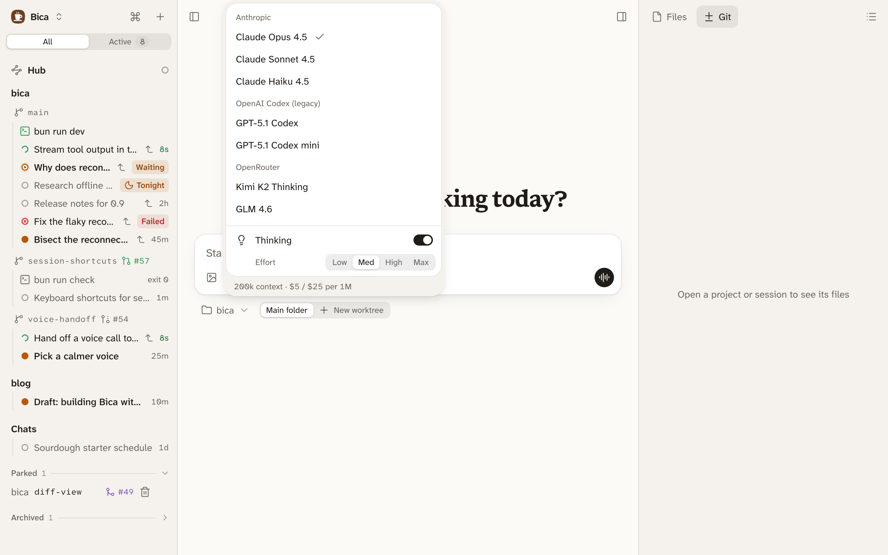

The composer is the box at the bottom of a session where you write to the agent. You don't have to wait for the agent to finish: a prompt can join the run in progress or wait for the next one.

## Send while the agent works

Enter sends. If the agent is working, your prompt joins the current run right after the step in progress, so you can correct course without stopping it. To keep a prompt for later instead, press ⌘Enter or pick Queue under the chevron next to the send button. A queued prompt starts the next run.



```d2 title="Where a prompt goes while the agent works"
direction: down
you: You {class: you}
run: Current run {class: focus}
tray: Queued {shape: queue}
next: Next run
you -> run: Enter
you -> tray: ⌘Enter or Queue
tray -> next: when the run ends
```

Prompts that haven't gone in yet wait on a tray above the composer. Send now on a queued line moves it into the current run, and clicking a line takes it back into the box to edit or clear. Every tab and device sees the same tray.

## Stop the run

To end a run, use Stop under the chevron, the stop button when the box is empty, or press Esc twice. Anything still waiting comes back into the box.

## Run tonight

On the home page, the chevron also offers Run tonight. It holds the new session until the night starts and runs it then, with a report in the morning. See [Night runs](/docs/features/night-runs/).

## Images and long pastes

Paste, drop, or pick an image with the Attach images button. A marker like `[Image #1]` lands where the cursor is, and its thumbnail shows the same number, so you can refer to images in order. Backspace right after a marker removes the image. A long paste folds into a marker like `[Pasted text #1 · 40 lines]` and is sent in full.

Each session keeps its own unsent draft on the device. ↑ at the start of the box brings back the prompts you sent before.

## Voice

With nothing typed, the send button becomes a sound-wave button that starts a [voice call](/docs/features/voice/) with the session. On a phone, the mic button next to it dictates into the box. Both need the OpenAI Codex (legacy) provider; without it the buttons don't show.

## The model picker

The model button at the bottom left of the composer picks the model for this session only, and you can change it at any time. Where a model supports it, the Thinking switch and Effort (Low to Max) set how hard it thinks. The foot shows the model's context window and price.



Settings chooses which models the picker lists and which one new sessions start on ([Providers and models](/docs/setup/providers/)).

## Next

- [Sessions](/docs/basics/sessions/): reading the transcript and the statuses.
- [The agent's tools](/docs/features/tools/): what the agent does with your prompt.
- [Keyboard shortcuts](/docs/reference/shortcuts/#composer): every key the composer takes.
