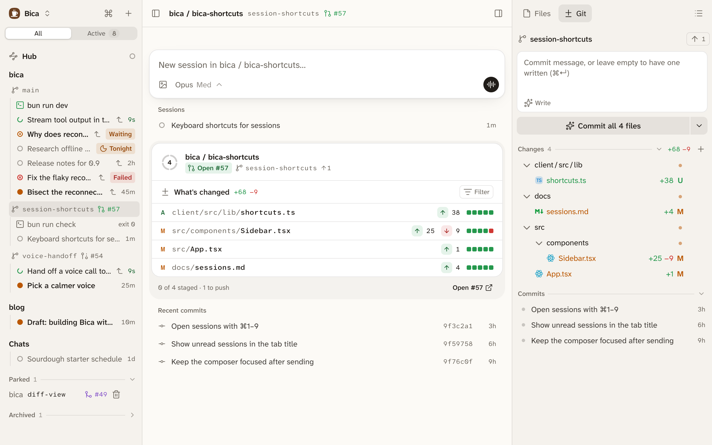
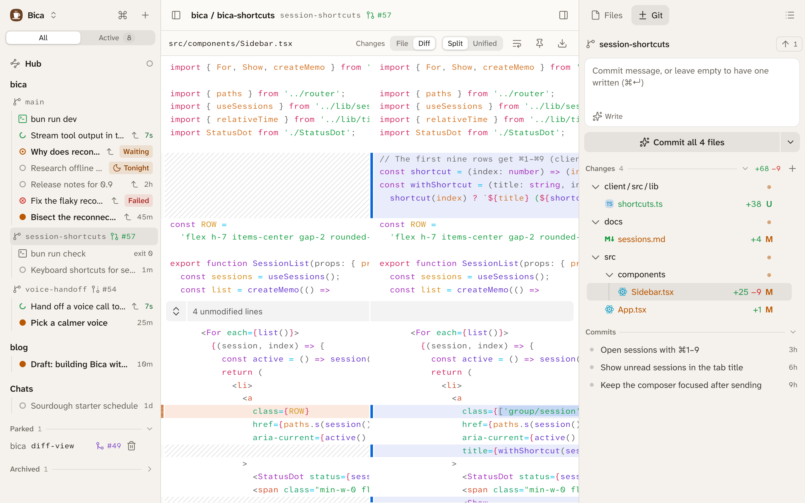

Bica is where you read the agent's work: whole files and full-screen diffs, from any browser. The files stay on your dev machine, and Bica shows them to you.

## The workspace page

Click a workspace in the sidebar to open its workspace page. At the top is a composer for a new session there, then the workspace's sessions. Below them, a card sums up the work: the branch, its [pull request](/docs/basics/git/#pull-request-badges), what's left to push, and a ring with a segment per changed file that fills as you stage. The changed files follow, with lines added and removed, and then the latest commits.

The side panel on the right has two tabs. Files shows the whole tree, with git colors and a name search. [Git](/docs/basics/git/) holds the changes and commits. The same side panel sits next to every session, so you can check a file without leaving the chat.

## Open a file or a diff

Click a file to open it full size in the centre. From a session, it covers the chat, and ✕ or Esc takes you back.

- File and Diff switch between the file and its changes. Split shows them side by side and Unified in one column. A phone always gets Unified.
- Images, PDFs, audio, and video show as themselves, before and after side by side in a diff.
- Markdown, HTML, and Mermaid open rendered, and the eye button shows the source.
- Keep open (the pin) lists the file in the sidebar, as a kept file, until you unpin it.
- Download saves the file through your browser, at any size, so you can get it onto your phone or another computer.
- Open in editor opens the file in your editor on the dev machine.

There are no tabs: opening something replaces what was there. The open file is in the address bar, so reload, back, and shared links all work. When you come back to a workspace, the Files tab, the open file, and its scroll are where you left them. An open diff refreshes on its own while the agent keeps editing.

## Paths in replies

File paths in the agent's replies are links. A click opens the file in Bica, so it works from your phone too. ⌘-click opens it in your editor instead, and Alt-click shows it in Finder.

## Select several files

In Files and in Git, ⌘-click and Shift-click select several files, and the right-click menu acts on all of them. Changed files show as a tree or a flat list.

## Next

- [Git and commits](/docs/basics/git/): committing what you reviewed.
- [Layout](/docs/basics/layout/): where the side panel sits on each screen size.
