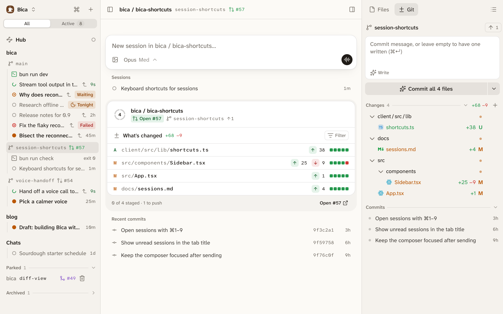

The Git tab is where you commit and push the agent's work. It sits in the side panel next to every session and on every workspace page, and it always shows that workspace's branch. If you know source control in VS Code, it works the same way.

## Commit and push

From the top down, the Git tab holds:

- The branch, with a button to pull, to push (it shows how many commits are waiting), or Publish for a new branch.
- The commit box. Its button says what it will do, such as Commit all 4 files. The arrow next to it has Commit and push, and Amend last commit.
- Staged and Changes, the files with lines added and removed. Click one to open its [diff](/docs/basics/files/). Its menu stages, unstages, or discards it.
- Commits, the branch's history.

Commit takes what's staged, or every change when nothing is staged. Discard asks before it throws anything away.

## Let the fast model write the message

Leave the commit box empty and press Commit (or ⌘Enter), and the fast model writes the message for you. Write puts the message in the box first, so you can read and edit it, and Rewrite asks for another. The message is one short line in the style of your recent commits, and it uses your prompts to the agents in this workspace to say why the change was made.

This needs a fast model. [Providers and models](/docs/setup/providers/#the-default-and-fast-models) sets one. Without it, you write the message yourself.

## Stage what you've reviewed

Turn on Stage on view in Settings → Behavior, and opening a file's diff under Changes stages it. Staged then means reviewed. If the agent edits the file again, only the new part shows under Changes.

## The commits list

Commits lists the branch's commits, newest first, and loads more as you scroll. An arrow marks the ones you haven't pushed yet.

Click a commit to open it full size, with its message, author, date, and changed files. Click a file to see its diff. Open on remote opens the commit on GitHub or GitLab once it's pushed, and the menu copies its hash or message.

## Pull request badges

Each branch shows its pull request's number and state, such as `#57` in green for open, in the sidebar and on the [workspace page](/docs/basics/files/#the-workspace-page). Click it to open the pull request on GitHub. A branch whose pull request is merged or closed offers to [remove its worktree](/docs/basics/projects/#clean-up-worktrees).

The badges come from the GitHub CLI on your dev machine. Install [`gh`](https://cli.github.com) and run `gh auth login` there, and they show up within a minute, without restarting Bica. Only your own pull requests get a badge. Without `gh`, Bica works the same, just with no badges.

You open and merge pull requests on GitHub, or ask the agent to run `gh pr create`.

## Folders without git

A folder that isn't a git repo shows "Not a git repository" instead of the Git tab. New projects and chats get a repo of their own, unless they sit inside another one.

## Next

- [Files and diffs](/docs/basics/files/): reading the changes before you commit.
- [Projects and worktrees](/docs/basics/projects/): one branch per feature, and removing it once merged.
