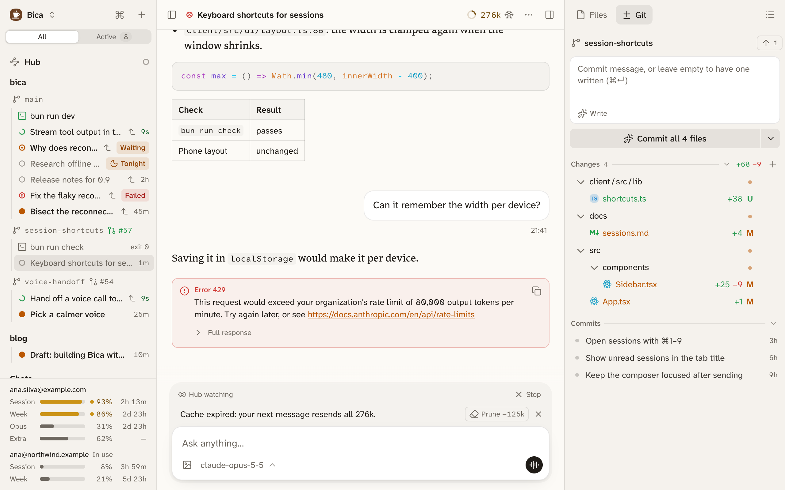

import { Image } from 'astro:assets';
import sidebarPhone from '../../../../assets/screens/sidebar-phone-light.png';
import panelPhone from '../../../../assets/screens/side-panel-phone-light.png';

Every page in Bica has the same three parts: the sidebar on the left to find your work, the page you opened in the centre, and the side panel on the right for the files and Git of the workspace you're in. A workspace is the folder a session works in: a project's main folder, or one of its worktrees.

## The sidebar

The sidebar lists the [hub](/docs/features/hub/), a session that coordinates the others, then your projects. Under each project, every workspace has its own line with its branch, and its terminals, kept files, and sessions below it. [Projects and worktrees](/docs/basics/projects/) explains what's listed and why some workspaces sit under Parked.

- The All and Active tabs at the top filter it. Active keeps the sessions that need you, the ones running, and any that moved in the last few minutes.
- The top row has the Bica menu (New session, Add project, Settings), the ⌘ button for the [command palette](/docs/basics/command-palette/), and + for a new session.
- The foot shows how much of each plan account you've used, for the open session's model.

## The centre

The centre shows what you opened: a [session](/docs/basics/sessions/), a workspace page with a file or diff, a [terminal](/docs/basics/terminals/), or Settings.

## The side panel

The side panel has two tabs for the open workspace. Files is the file tree, and a click opens the file full size in the centre ([Files and diffs](/docs/basics/files/)). Git shows the changes, the commit box, and the branch's commits ([Git and commits](/docs/basics/git/)). Bica remembers the tab you picked when you move to another session. Hub sessions don't work in a project, so they have no side panel.

## On each screen size

| Screen | Sidebar | Side panel |
| --- | --- | --- |
| Phone | Slides in from the left | Slides up from the bottom |
| Tablet | A column | Slides in from the right |
| Wide screen | A column | A column |

On the phone the centre gets the whole screen, and the two buttons at the ends of the top bar bring in the sidebar and the side panel:

  <Image src={sidebarPhone} alt="The sidebar slid in from the left on a phone, over the session" />
  <Image src={panelPhone} alt="The side panel slid up from the bottom on a phone, showing the Git tab" />

⌘B shows or hides the sidebar, ⌥⌘B the side panel, and Esc closes whichever one slid in. On a wide screen, drag a column's inner edge to resize it, and double-click the edge to reset it.

## Next

- [Sessions](/docs/basics/sessions/): what fills the centre most of the time.
- [Command palette](/docs/basics/command-palette/): go anywhere with ⌘K instead of the sidebar.
- [Use it from your phone](/docs/start/phone/): reach Bica on the phone.
