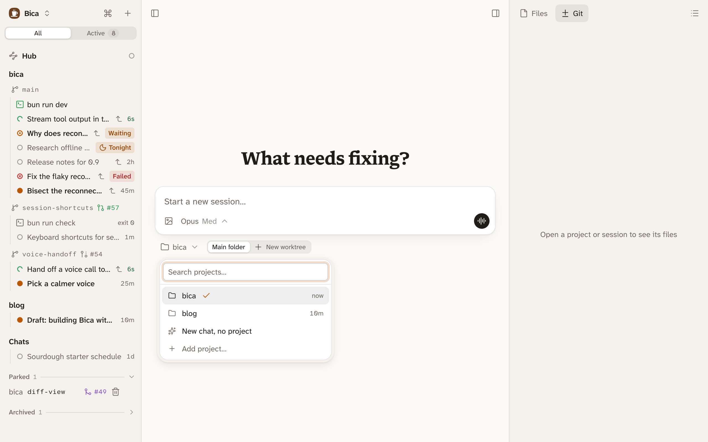
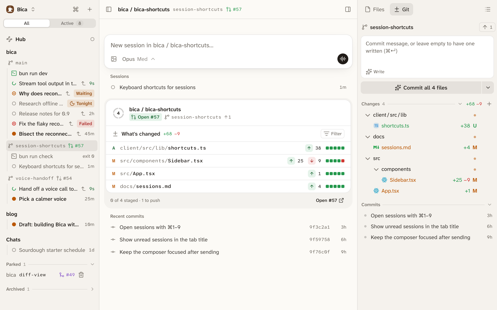

A project is a folder on your dev machine that you want agents to work in, usually a git repo. Each session runs in the project's main folder or in one of its git worktrees, so you can give each feature its own folder and run several agents at once without them touching each other's files.

## One worktree per feature

A worktree is a second checkout of the same repo, in its own folder and on its own branch. All of them share one git history.

```d2 title="One repo, three folders, one agent in each"
direction: right
repo: shop repo {class: store}
main: "shop\nagent: release notes" {class: files}
a: "shop-checkout\nagent: fix checkout" {class: files; style.bold: true}
b: "shop-dark-mode\nagent: dark mode" {class: files; style.bold: true}
repo -> main
repo -> a
repo -> b
```

Each agent edits and runs tests in its own folder, and you commit and push each branch on its own from its [Git tab](/docs/basics/git/).

## Start a session

On the home page, under the composer, the project menu picks the project. Next to it, a switch picks Main folder or New worktree.



New worktree makes a branch named after the session, in a folder next to the project's: `shop` gets `shop-dark-mode`. It starts from the latest default branch. If the remote wants a sign-in or doesn't answer, it starts from the last fetched copy, and a toast says so. The worktree also gets copies of the main folder's ignored files, such as `.env` and `node_modules`, so it runs without a fresh install. That needs a disk that can clone files, such as APFS on macOS or btrfs and XFS on Linux; on other disks nothing is copied, and the agent installs what it needs.

To keep working in a worktree you already have, use the + on its row in the sidebar, or New session in… in the [command palette](/docs/basics/command-palette/).

Add project… in the same menu opens a folder browser on the dev machine. A folder without git works too, but it gets no worktrees. Edit project, in a project's menu in the sidebar, renames it.

## In the sidebar

The sidebar lists each project with its workspaces: the main folder and every worktree, each on its own line with its branch and [pull request](/docs/basics/git/#pull-request-badges). Under each one are its terminals, kept files, and sessions. Click a workspace's line to open its [workspace page](/docs/basics/files/).

- Drag a project's name to reorder projects.
- A workspace with nothing open moves down to Parked, so a worktree waiting on review stays out of the way. Pin project keeps a main folder in the list.
- A ticket key at the start of a branch name shows as a small tag.



## Chats

A chat is a session with no project. Pick New chat, no project in the project menu. Each chat gets its own empty folder under `~/.bica/chats`, so the agent can still write files. Chats are listed last in the sidebar.

## Clean up worktrees

Remove worktree, in a worktree's menu in the sidebar, deletes its folder and local branch, archives its sessions, and closes its terminals. It asks first if you would lose uncommitted files or commits that aren't merged. A branch whose pull request was squash-merged counts as merged.

You'll also see Remove worktree as a button once the [pull request](/docs/basics/git/#pull-request-badges) is merged or closed, and in the toast when you archive the last session in a worktree.

Bica also cleans up on its own every hour. It removes a worktree whose pull request merged and that has sat idle for a day, or one unused for a week whose commits are all on the default branch. It never touches a worktree with uncommitted files or a running session.

## Next

- [Files and diffs](/docs/basics/files/): reading the agent's changes.
- [Git and commits](/docs/basics/git/): committing and pushing each branch.
