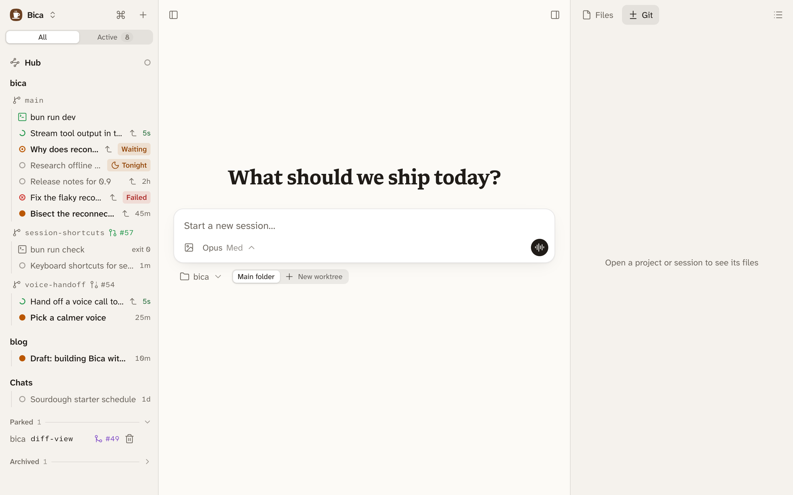
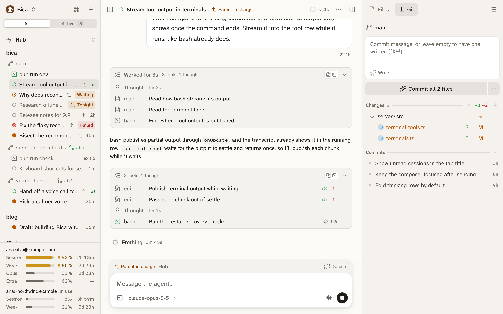

import Demo from '../../../../demos/Demo.astro';

A session is one conversation with an agent, working in one folder of your project: its main folder or a worktree. Each session has its own model, transcript, and queue of prompts, and you can run many at once.

Sessions keep running when you close the tab, and a restart loses nothing ([how it works](/docs/start/how-it-works/#sessions-keep-running)).

## Start one

The home page is a composer. Pick the project and Main folder or New worktree under it, write your first prompt, and send. The [fast model](/docs/setup/providers/#the-default-and-fast-models) names the session after that prompt. Click the title in the top bar or the sidebar to rename it.

## Read the transcript

The transcript shows your prompts, the agent's replies, and the work in between.

- Thinking and tool calls between two replies fold into one list, headed like "Worked for 18s · 6 tools, 1 thought". Open a call to see its command and output, its diff, or its arguments.
- While the agent works, one line at the bottom shows how long the run has taken.
- Replies can hold diagrams, and a file path in a reply opens that file in Bica.
- Hover a reply to copy it or fork from it.
- Opening a session takes you back to where you were reading.

To hide thinking on one device, use Settings → Appearance → Hide thinking.

## Status shows which sessions need you

A dot next to each session in the sidebar shows its status.

<Demo name="status" />

- Running: the agent is working, and the row shows a clock.
- Retrying: the provider failed, and Bica will try again.
- Waiting for you: the agent [asked you a question](/docs/features/tools/#the-agent-can-ask-you-questions).
- Unread: the run finished with a reply you haven't opened.
- Failed: the last run ended in an error. A strip above the composer explains when the work is stuck, with Retry or Stop.
- Idle: everything else, including a run you stopped.

Waiting for you, Unread, and Failed count as needing you. Opening a session marks it read on every device. A chime plays when a session stops, and the installed app's icon shows how many need you.

## Session actions

The ⋯ menu in the top bar, a session's menu in the sidebar, and ⌘K offer the same actions: Stop, Mark as unread, Rename, Fork, Archive, and a few more.

Fork makes a new session with the history up to a reply you pick, from Fork from here on that reply. It works in the same folder, so the files aren't rolled back.

Archive moves a session to Archived at the bottom of the sidebar. Nothing is deleted, and the toast's Undo or sending it a prompt brings it back.

- If the session leads [child sessions](/docs/features/orchestration/) or terminals, Bica asks which go with it. Child sessions you leave stay open, detached from it.
- Archiving the last open session of a worktree offers to remove the worktree too.
- A running session can't be archived by you, but you can ask the agent to archive its own session, which happens when its turn ends.
- To archive many, ⌘-click or shift-click them in the sidebar and use the bar at the bottom.

## Next

- [Prompting](/docs/basics/composer/): sending while the agent works, images, and the model.
- [The agent's tools](/docs/features/tools/): what the agent can do in your project.
- [Orchestration](/docs/features/orchestration/): sessions that start and follow other sessions.
