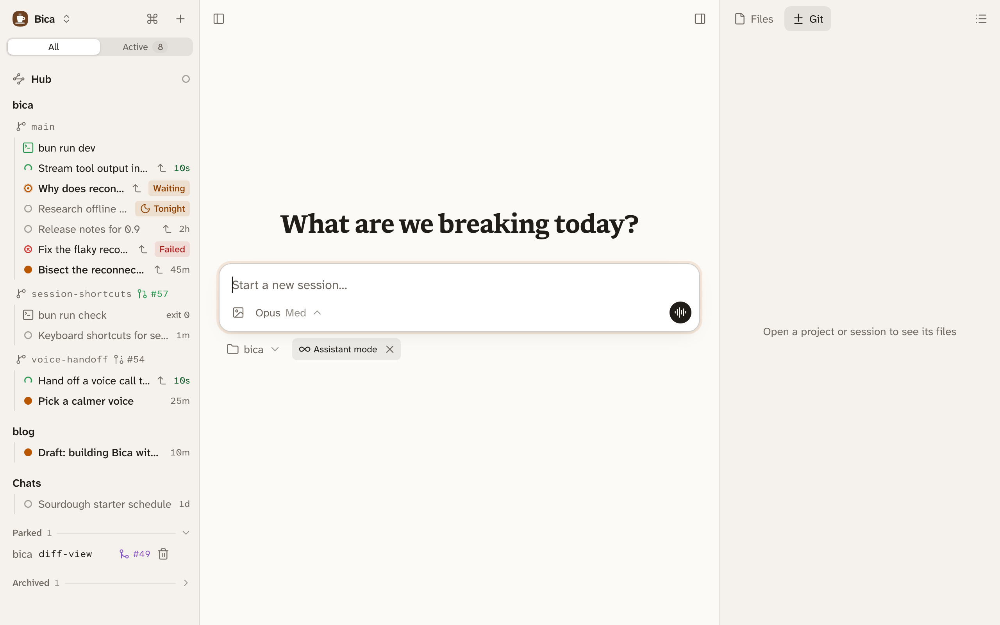

Assistant mode is for a session you never close. Most sessions are a task you finish and leave. Some are a companion instead, like a notes vault you talk to every day or a helper for one project. Assistant mode keeps that kind of session going for months without you thinking about its size, its cost, or when to start over.

## Start one

Press ⌘K and pick New assistant session. The start screen shows an Assistant mode tag next to the project menu, and × on the tag goes back to a normal session. An assistant session always works in the project's main folder, and shows an infinity sign next to its title.



To switch an existing session, open its ⋯ menu and pick Turn on assistant mode, or Turn off assistant mode to make it a normal session again.

## Memory lives in files

A long conversation gets expensive, because every prompt resends everything before it. It also gets forgetful, because models do worse as the context grows, and every summary loses detail. So an assistant keeps two kinds of memory: the conversation for what's recent, and files for what lasts.

```d2 title="The conversation stays short; what matters goes into memory files, which come back with every prompt"
direction: down
chat: "Conversation\nshort-term, trimmed while idle"
files: "Memory files\nin the project" {class: files}
prompt: "Next prompt\nstarts with MEMORY.md" {class: focus}
chat -> files: the agent saves what matters
files -> prompt: read in at the start
prompt -> chat
```

The agent writes decisions, preferences, and open tasks to its memory files as they come up, keeps only what stays true, and replaces facts that changed. The files are plain markdown in the project, starting from `MEMORY.md`, so you can read and edit them, and they don't depend on Bica.

An assistant is told it helps with notes, planning, research, answers, and quick fixes. Bigger coding tasks go to sessions of their own.

## Bica tidies it while it's idle

Between runs, so it never interrupts you, Bica shrinks the session the way you would by hand with [Compact and Prune](/docs/features/context/#compact-and-prune):

1. Once the prompt cache has expired, it prunes old tool output. Your prompts and the replies stay.
2. If the session is still big, it asks the agent to save what's worth keeping to its memory files, then compacts the older part while that is still cheap.

:::note
This tidying needs Anthropic's models, whose cache lifetime Bica knows. On other models, compact or prune by hand.
:::
