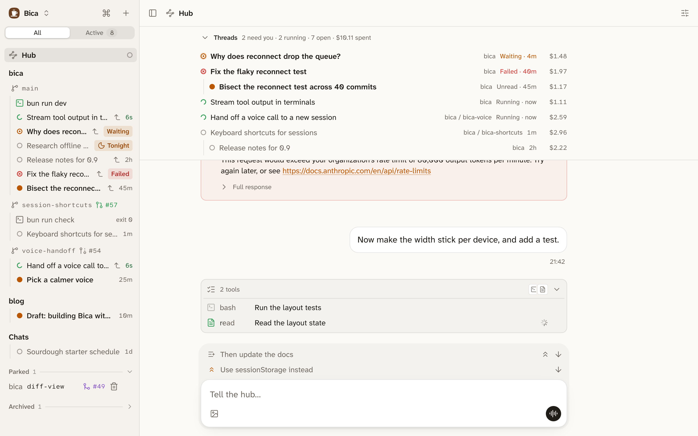

The hub is one long-lived session you talk to about all your work, often by voice from the phone. It knows your projects, keeps notes on every open thread, and tells you where everything stands. When you say go, it starts and messages sessions to do the work. It never does the work itself.

Use it when you run many sessions across projects and want one place to ask "what needs me?". For one task, a normal session with [child sessions](/docs/features/orchestration/) is enough.

## Set it up

1. In Settings → Hub, set Hub folder to a folder for its notes, such as a `Hub` folder in your notes vault.
2. Open Hub at the top of the sidebar, or from the [command palette](/docs/basics/command-palette/). The first open starts it.

There is one hub, outside any project. It runs on its own model, Claude Sonnet 5.5 at low effort unless you change it in Settings → Hub. The sessions it starts use your default model.

## Its page



At the top is the board, labelled Threads: the sessions the hub started or follows, and any session that asks you a question or failed. What needs you comes first, and each row shows what its work cost and opens that session. Below the board is the chat, with a [voice call](/docs/features/voice/) button.

```d2 title="You talk to the hub; it runs the work through sessions and keeps its notes in files"
direction: down
you: You {class: you}
hub: Hub {class: focus}
sessions: Sessions {style.multiple: true}
notes: Notes in its folder {class: files}
you <-> hub: chat or voice call
hub -> sessions: start, message, on your go
sessions -> hub: report when a run ends
hub <-> notes
```

## How it works with you

The hub proposes and then waits. Without asking, it reads sessions and files, checks a finished session's report against what it asked for, and tells you what finished and what it suggests next. Starting, messaging, stopping, or archiving a session waits for your yes, unless you just asked for exactly that.

It hears when its own sessions finish, and when any session asks you something or fails. To follow a session it didn't start, it watches it, and that session shows a Hub watching strip; Stop there ends the watch. Sessions you started stay yours: the hub only reports on them.

The hub reads files anywhere and terminals too, but writes only in its own folder and has no shell. Its notes start with `MEMORY.md`, one line per open thread. Bica tidies it while idle, like an [assistant mode](/docs/features/assistant-mode/) session, so it can run for months.
