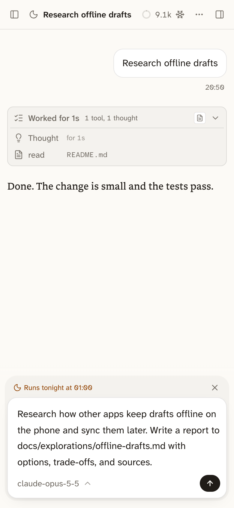

A night run is a session held for tonight. Its prompt waits until night, runs on its own while you sleep, and ends with a report for the morning. Use it for work that can wait and finish without you, such as research, docs, chores, and refactors, so your plan's limits don't go unused overnight.

## Hold a prompt for tonight

Type a prompt on the start screen, open the chevron next to the send button, and pick Run tonight. The session's sidebar row shows a Tonight tag, and a strip above its composer says when it runs.

Until then, the composer edits that prompt and saves as you type. The send button, labelled Run now, runs it right away, and the strip's × turns it back into a normal draft.

You can also ask the [hub](/docs/features/hub/), or any session, to hold work for tonight. The session that held it hears the report.

## What happens overnight

Night runs start at 01:00, or the time you pick under Night runs start at in Settings → Behavior. Bica runs them on its own, so no browser needs to be open.

- They run one at a time, oldest first, so they don't drain the plan twice as fast.
- New runs start only in the first 5 hours after the start time, so a late one doesn't eat into your morning.
- A run starts only while its plan has room, keeping the last 20% of the week for the days ahead. With [more than one account](/docs/setup/providers/#more-than-one-account-on-a-plan), one with room is enough.
- After 3 hours, a run is told to wrap up and write its report, and it's stopped 20 minutes later.

Pick a start time at least 5 hours before your day starts, so the night's plan window ends before yours begins.

## The morning report

A night run works without asking you anything, since nobody is awake to answer. It takes choices that are easy to undo and notes them, proves its work by running checks, and stays away from push, merge, and deploy.

Its last reply is the report. The first line says Done, Partly done, or Blocked. Then come what changed, the checks it ran and their results, the decisions it took alone, open questions, and the next step. After that it is an ordinary session you can continue.

Name in your prompt the command that proves the work is done, such as the tests to run. Agents left alone tend to claim work they didn't finish, and a named check gives the report something to measure against.
