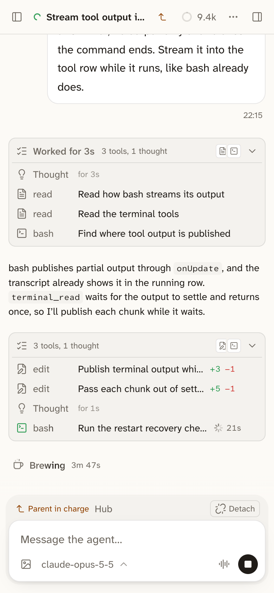

A session can start other sessions to split up a job, such as one per bug or one per part of a feature, each in its own worktree. The session that starts them is the parent, and the ones it starts are its child sessions. They are normal sessions in your sidebar, which you can open, watch, and write to.

To use it, ask the agent: "start a session for each of these bugs, each in its own worktree".

## A child session reports to its parent

Each time a child session finishes a run, Bica sends its parent a note with the child's last reply. The parent reads it, checks the work, and can send the child more to do. While it waits, the parent costs nothing.

```d2 title="A parent starts a child session and hears each run it finishes, until you detach it"
direction: down
you: You {class: you}
parent: Parent session
child: Child session {class: focus}
parent -> child: starts it, sends more work
child -> parent: note when a run ends
you -> child: write to it, or Detach {style.stroke-dash: 3}
```



- A child session sits under its parent in the sidebar when both work in the same folder. The Parent in charge strip above its composer links to the parent.
- You can write to a child session at any time. Your words come before the parent's plan, and the parent sees them in its next note.
- Detach, in that strip, makes the session yours for good. The parent is told to leave it alone and hears nothing more from it.
- An agent can also start a session already detached, for work it hands off and doesn't need to hear about.
- Sessions you start yourself, and forks, have no parent.

Agents leave alone the sessions they didn't start, unless you name them, and they name sessions to you by their title.

## Archiving

When the work is done, archive the child sessions from the sidebar, or tell the parent to. A session archives itself only when you tell it to, and a running one waits for its turn to end first.

Archiving a parent asks which of its open child sessions and terminals go with it. The child sessions you keep are detached, since an archived parent can't hear from them.

## Other ways to split the work

- [The hub](/docs/features/hub/) is one session that runs work across all your projects through child sessions.
- [Night runs](/docs/features/night-runs/) hold a session's prompt until tonight.
- [Assistant mode](/docs/features/assistant-mode/) is for a session you keep for months.
