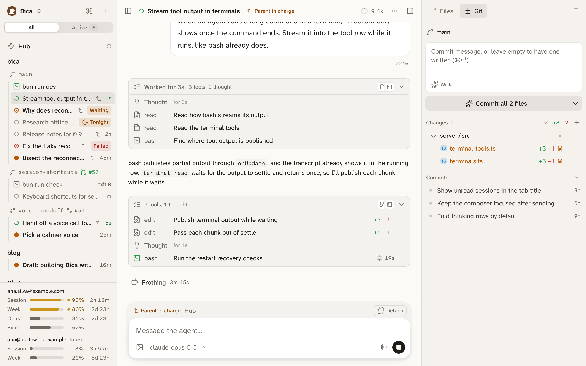

import Demo from '../../../../demos/Demo.astro';

The agent does its work through tools. Each tool call shows in the transcript with a one-line summary of what it is for, so you can follow a run as a list of intentions.

## What the agent can do

- Read, write, and edit files in the session's folder, and look at images.
- Run shell commands.
- Search the web and read pages, once you add an [Exa key](/docs/setup/providers/#exa-turns-on-web-search).
- Start and use the [terminals](/docs/basics/terminals/) you share with it, for dev servers and long jobs.
- Start, read, and message other sessions. See [parents and child sessions](/docs/features/orchestration/).
- Ask you multiple-choice questions.

To save time, the agent can also write a short script that calls several tools at once and keeps only what matters from their output. Each call in the script still shows in the transcript.

Some sessions get fewer tools. The [hub](/docs/features/hub/) has no shell, and a [night run](/docs/features/night-runs/) can't ask you anything.

## Tools run without asking

Bica has no approval prompts and no sandbox. Commands and edits run as your user, so they can reach anything you can. The agent's [instructions](/docs/features/instructions/) tell it to keep git read-only unless you ask, and to explain and confirm before anything destructive. That is a rule it follows, and nothing enforces it. To stay safe:

- Give each feature its own [worktree](/docs/basics/projects/), so agents never edit the same folder.
- Stop a run at once with the stop button, or Esc twice in the [composer](/docs/basics/composer/#stop-the-run).
- Throw away a file's changes with Discard in the [Git tab](/docs/basics/git/).

## The agent can ask you questions

When the agent needs a decision, it puts one to four multiple-choice questions to you and stops. The session shows Waiting for you. The card below is the real one with sample questions. Try it: nothing is sent.

<Demo name="ask" />

Nothing times out, so you can answer hours later from another device. Click an option, press its number key, or type your own answer in the card or the composer. Once answered, the card folds into one row.
