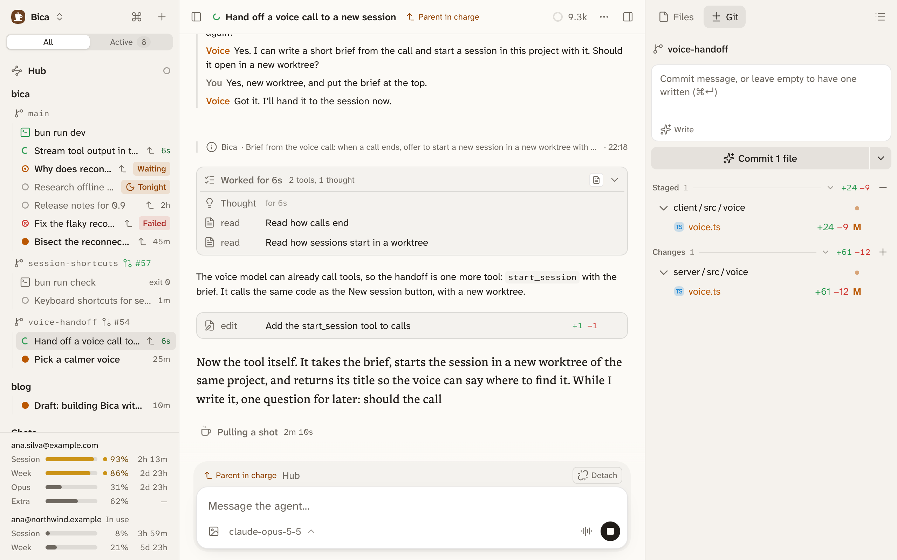

A voice call lets you talk to a session instead of typing, which helps most away from the desk. Dictation on the phone turns what you say into text in the composer.

:::caution[Unofficial route]
Calls and dictation sign in to your ChatGPT plan the way OpenAI's Codex app does. That route isn't meant for other apps, so OpenAI may break or block it at any time.
:::

## Start a call

With nothing typed, the send button becomes a sound-wave button: press it to start a call. On the start screen, that starts a new session with the call on it. While the agent works, the call button sits next to stop.

During a call the composer becomes the call panel, with a level meter, live captions, the model picker, mute, and a red End call button.

## The voice talks, the session works

The voice, OpenAI's GPT-Live, only listens and talks. When something needs the agent, it hands your words to the session, which does the work with its own model and tools, and the voice tells you the result.

```d2 title="A call hands your words to the session, and speaks its reply"
shape: sequence_diagram
you: You
voice: Voice
session: Session {class: focus}
you -> voice: speech
voice -> session: your words
session -> voice: progress, then the reply
voice -> you: speech
```

Each handoff arrives as an ordinary prompt, so the whole call stays in the transcript.



- The voice passes on your own words without rephrasing them.
- Speaking while the agent works joins the run at once, so "no, the other branch" lands before the wrong thing is done.
- "How's it going" gets the latest progress, and "stop" stops the run. Long runs never time out.
- The photo button adds photos, or opens the camera on a phone. They go with your next request: take a picture, then ask "what's wrong with this?".

While the agent works in silence, quiet music from [SomaFM](https://somafm.com) plays, so you know it's still going. Voice settings, in the session's ⋯ menu, set its speaking speed, instructions such as "talk with me in simple French", and the music's volume. Turning off Sounds in Settings silences the music.

## Dictation on the phone

The mic button in the composer records until you tap its check, then writes the text where the cursor is. It hears names and code words better than the keyboard's dictation. The recording goes to ChatGPT's transcription, and ChatGPT keeps it for 30 days.

## What you need

- The OpenAI Codex (legacy) provider, signed in with a ChatGPT plan, in [Settings → Providers](/docs/setup/providers/#connect-a-provider). The newer Sign in with ChatGPT doesn't cover voice. Without it, the call and mic buttons don't show.
- A secure page for the mic: `localhost`, or the HTTPS address from [Use it from your phone](/docs/start/phone/).
- On iOS, the mic keeps working with the phone locked in Safari and Chrome, but not in Bica added to the home screen.

If a call goes wrong, each step is logged to `voice-log.jsonl` in the data folder.
