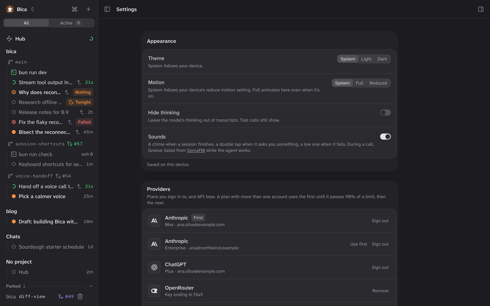

Settings is one page of cards, from how Bica looks to which models it runs. Open it from the Bica menu at the top of the sidebar, or type "settings" in the [command palette](/docs/basics/command-palette/). Changes apply as you make them; there's no Save button.

## The cards

| Card | What it's for | More |
| --- | --- | --- |
| Appearance | How Bica looks and sounds on this device. | Below |
| Providers | Plan sign-ins, API keys, the order of your accounts, and Exa for web search. | [Providers and models](/docs/setup/providers/) |
| Models | The model new sessions start with, the fast model, and Keep the cache for an hour. | [Providers and models](/docs/setup/providers/#the-default-and-fast-models), [Context](/docs/features/context/) |
| Model picker | Which models each session's picker offers. With none chosen, all of them. | [Prompting](/docs/basics/composer/#the-model-picker) |
| Hub | The folder where the hub keeps its memory files, and its model. The hub starts once the folder is set. | [The hub](/docs/features/hub/) |
| Behavior | Night runs start at (01:00 unless you change it), and Stage on view. | [Night runs](/docs/features/night-runs/), [Git](/docs/basics/git/) |

## Appearance stays on this device

Appearance is saved in the browser, so your phone can be dark while your laptop is light. Every other card is saved on the server, and every device sees the same values.

- Theme picks System, Light, or Dark. System follows your device.
- Motion on System follows your device's reduce motion setting. Full animates even when that's on, and Reduced turns animations down.
- Hide thinking leaves the model's thinking out of transcripts. Tool calls still show.
- Sounds plays a chime when a session finishes, a double tap when it asks you something, a low tone when it fails, and [hold music](/docs/features/voice/) during a call.

## What isn't in Settings

- One session's model and effort: its [model picker](/docs/basics/composer/#the-model-picker).
- Voice speed and instructions: Voice settings in the session's ⋯ menu. See [Voice](/docs/features/voice/).
- The port and data folder: flags and environment variables when you start `bica`. See [CLI](/docs/reference/cli/).

## Next

- [Providers and models](/docs/setup/providers/): connect a provider and pick the default and fast models.
- [CLI](/docs/reference/cli/#the-data-folder): where settings and sign-ins are saved on disk.
